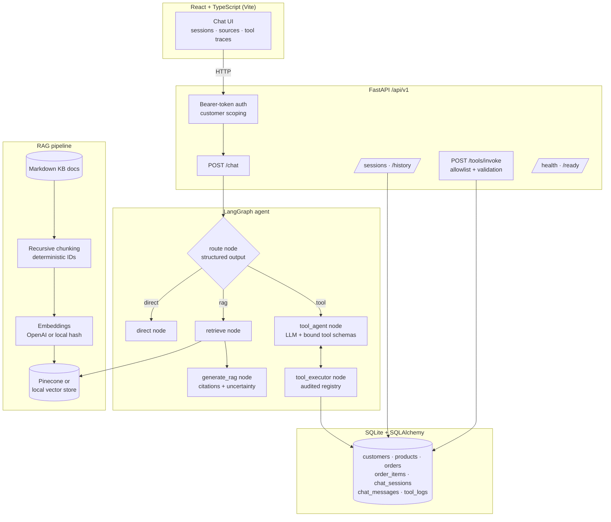

# Agentic Retail Support Assistant

An agentic customer-support assistant for an e-commerce retailer. A **LangGraph** agent decides per message whether to **answer directly**, **retrieve grounded context** from a knowledge base (RAG over **Pinecone** / local vector store with **OpenAI** embeddings), or **execute tools** (order lookup, return-eligibility check, product details) against a SQL database — exposed as a versioned **FastAPI** service with persistent, customer-isolated chat sessions and a **React** chat UI.

**Runs fully offline out of the box**: without API keys the system transparently falls back to a deterministic mock LLM, hashed local embeddings, and a JSON-persisted vector store. The same LangGraph workflow, tools, persistence, tests, and evaluation harness execute in both modes; adding `OPENAI_API_KEY` / `PINECONE_API_KEY` switches to the real providers with zero code changes.

---

## Architecture



### How the agent works

1. **route** — the LLM classifies the latest message (`direct` | `rag` | `tool`) via a Pydantic structured-output schema (`RouteDecision`), using conversation history to resolve references like *"can I return **it**?"*.
2. **direct** — greetings/small talk are answered without retrieval or tools (no wasted latency/cost).
3. **retrieve → generate_rag** — the query is embedded, the vector store returns top-k passages with scores and metadata; the answer must be grounded in that context and cites document titles. If nothing clears the relevance threshold, the agent says it doesn't know instead of guessing.
4. **tool_agent ⇄ tool_executor** — the LLM emits tool calls against bound schemas; a custom executor node runs them through the **allowlisted tool registry** (Pydantic argument validation, customer-scoped SQL queries, audit logging to `tool_execution_logs`) and feeds `ToolMessage` results back until the LLM produces a final answer (bounded by `MAX_TOOL_ITERATIONS`). Multi-tool turns are supported (e.g. *"What was in ORD-1004 and can I return it?"* → `lookup_order` + `check_return_eligibility`).

### When and why tools are called

Anything requiring the **customer's own data** goes through tools: order status/tracking (`lookup_order`), return eligibility computed from the actual order record + published policy (`check_return_eligibility`), structured catalog data (`get_product_details`). General policy/product questions go through RAG; pleasantries are answered directly.

### Security model

- Demo bearer tokens (`demo-alice`, `demo-bob`, `demo-carol`) resolve to customers; **every** order/session/tool access is scoped to the authenticated customer. A guessed order ID belonging to someone else returns the same "not found" as a nonexistent one (no enumeration).
- `POST /api/v1/tools/invoke` executes **only** registry-allowlisted tools with schema-validated arguments — never arbitrary functions.
- Retrieved documents are treated as untrusted data: the RAG prompt instructs the model to ignore imperative instructions found inside documents (prompt-injection defense), and the v2 prompt pack is evaluated for exactly this behavior.

---

## Project layout

```
backend/
  app/
    agent/            # LangGraph graph, nodes, state, mock+real LLM, versioned prompts (v1/v2)
    api/              # deps (auth/DI), middleware (request IDs), errors, v1 router
    data/docs/        # Markdown knowledge base (policies, catalog, FAQ)
    db/               # SQLAlchemy models, engine, seed data
    rag/              # loader, chunking, embeddings, vector stores, retriever, ingest CLI
    schemas/          # Pydantic API contracts
    services/         # order / returns / product / session services, tool registry
    config.py         # pydantic-settings, env-driven
    main.py           # app factory
  evals/              # dataset (38 cases), metrics, LLM judges, runner, compare tool
  tests/              # pytest suite (offline, deterministic) + optional integration tests
frontend/             # React + TS + Vite chat UI
examples/             # ready-to-run HTTP requests
docker-compose.yml
```

---

## Setup

Requires Python 3.11+ and Node 18+.

```bash
# 1. Backend
python -m venv .venv
.venv\Scripts\activate              # Windows   (Linux/macOS: source .venv/bin/activate)
pip install -r backend/requirements.txt

# 2. Configuration (optional — skip to run offline)
copy .env.example .env               # add OPENAI_API_KEY / PINECONE_API_KEY if you have them

# 3. Seed the database and build the vector index
cd backend
python -m app.db.seed
python -m app.rag.ingest --clear

# 4. Run the API  →  http://localhost:8000  (Swagger UI at /docs)
uvicorn app.main:app --reload --port 8000

# 5. Frontend  →  http://localhost:5173
cd ../frontend
npm install
npm run dev
```

### Docker

```bash
docker compose up --build   # UI on http://localhost:8080, API on :8000
```

### Configuring OpenAI and Pinecone

Set `OPENAI_API_KEY` (chat + embeddings) and/or `PINECONE_API_KEY` (vector store) in `.env`. With `*_PROVIDER=auto` (default), each real service is used when its key exists. Re-run `python -m app.rag.ingest --clear` after switching embedding providers — vector dimensions differ. The Pinecone index is created automatically (serverless, cosine metric).

### Demo identities

| Customer | Token | Interesting data |
|---|---|---|
| Alice Johnson | `demo-alice` | ORD-1001 in transit · ORD-1002 returnable · ORD-1003 window expired |
| Bob Martinez | `demo-bob` | ORD-1004 electronics + gift card (mixed eligibility) · ORD-1005 processing |
| Carol Chen | `demo-carol` | ORD-1006 final-sale + expired electronics · ORD-1007 cancelled |

---

## Tests and evaluations

```bash
cd backend

# Unit + API + agent tests (offline, no API keys needed): 51 tests
python -m pytest

# Optional integration tests against real OpenAI/Pinecone
python -m pytest -m integration

# Evaluation harness (38 scenario cases; writes JSON + Markdown reports)
python -m evals.run_eval --label baseline
python -m evals.run_eval --prompt-version v1 --label v1
python -m evals.run_eval --top-k 2 --label topk2
python -m evals.run_eval --chunk-size 400 --chunk-overlap 60 --label small-chunks
python -m evals.run_eval --judge          # adds LLM-as-judge scores (needs OPENAI_API_KEY)

# Compare two runs (improvements / regressions / still-failing cases)
python -m evals.compare evals/results/<A>/report.json evals/results/<B>/report.json
```

The harness measures **retrieval quality** (Recall@k, Hit Rate@k, MRR against labeled relevant documents), **agent correctness** (routing accuracy, tool selection, tool arguments, expected invocation sequence, tool outcome), and **response quality** (keyword assertions, citation presence, token-overlap groundedness, explicit uncertainty handling), plus optional LLM-as-judge rubrics for relevance/groundedness/tone.

### Recorded results (offline deterministic mode, 2026-11-07)

| Config | Cases passed | Recall@k | Hit@k | MRR | Groundedness | Uncertainty |
|---|---|---|---|---|---|---|
| v2 · top-k 4 · chunks 800/120 | **38/38** | 1.00 | 1.00 | 1.00 | 0.90 | 1.00 |
| v1 · top-k 4 · chunks 800/120 | 38/38 | 1.00 | 1.00 | 1.00 | 0.90 | 1.00 |
| v2 · top-k 2 | 38/38 | **0.96** | 1.00 | 1.00 | 0.90 | 1.00 |
| v2 · chunks 400/60 | **32/38** | 1.00 | 1.00 | **0.88** | **0.70** | **0.50** |

Takeaways: shrinking chunks to 400/60 fragments policy sections and measurably hurts ranking (MRR), groundedness, and uncertainty handling (6 case regressions, identified per-case in `evals/results/compare_chunks800_vs_400.md`); top-k 2 loses recall on multi-document questions. Prompt v1 vs v2 is identical **in mock mode** because the deterministic mock ignores prompt wording — the differences (few-shot routing, injection defense, citation rules) are designed to be measured with `--real-llm` once an OpenAI key is configured.

---

## Example conversation

> **Customer (Alice):** Where is my order ORD-1001?
> **Assistant** *(route: tool · lookup_order)*: Your order ORD-1001 is currently **shipped**. Tracking number TRK-84512093 via UPS. Estimated delivery: 2026-11-10. Items: Aurora Wireless Headphones (x1), LumenGlow Smart Lamp (x1).
>
> **Customer:** Can I return it?
> **Assistant** *(route: tool · check_return_eligibility — "it" resolved from history)*: Order ORD-1001: Orders can only be returned after delivery. This order is still in transit; once it is delivered, the return window begins.
>
> **Customer:** What's your return policy for electronics?
> **Assistant** *(route: rag · cites [Returns & Refunds Policy])*: Electronics may be returned within 15 days of delivery…

---

## Architectural trade-offs & future improvements

- **Rule-based offline fallbacks** keep the demo, CI, and evals free and deterministic, at the cost of shallower language understanding in mock mode. The provider seam (`get_chat_model`, `get_embedding_provider`, `get_vector_store`) means the real services are a config change, not a refactor.
- **Local hashed embeddings** are lexical (stemmed bag-of-words); they rank this small corpus well (MRR 1.0 on the eval set) but would not scale semantically — that's what the OpenAI + Pinecone path is for.
- **SQLite** is right-sized for a demo; the SQLAlchemy layer makes Postgres a connection-string change. Demo bearer tokens stand in for a real identity provider (OIDC/JWT) — the auth dependency is the single place to swap.
- **Graph-per-request** compilation is cheap for this graph size and keeps the runtime bound to a request-scoped DB session; a high-throughput deployment would compile once and inject context via LangGraph's configurable runtime.
- Future: streaming token responses (SSE), semantic re-ranking, hybrid (BM25 + dense) retrieval, LangGraph checkpointing for resumable long workflows, human-handoff escalation, rate limiting.
